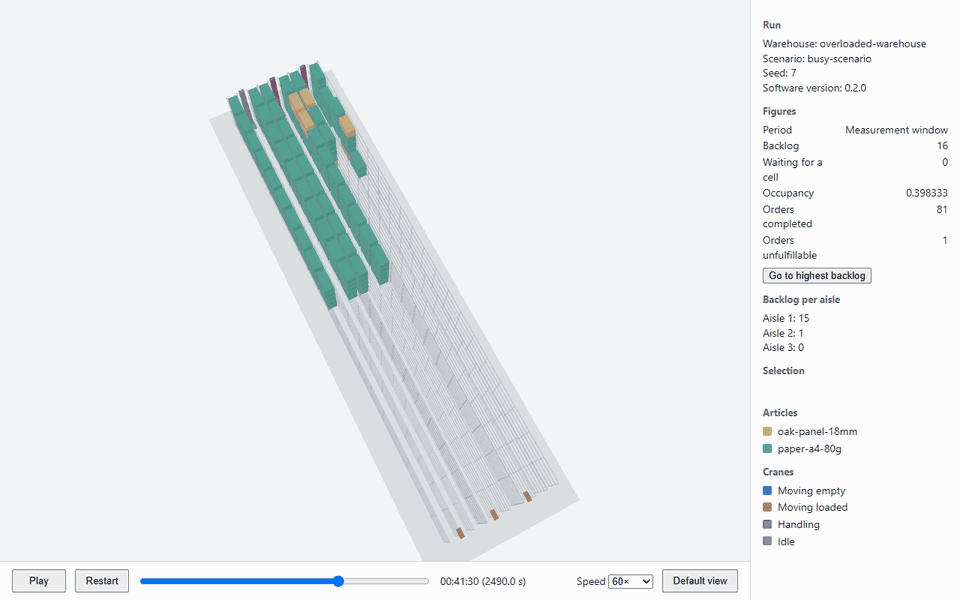

# Highbay Warehouse Digital Twin

A command-line throughput simulation of one high-bay warehouse, written in Python. It runs with no graphical interface. A warehouse and an order scenario are defined in YAML files, and each run writes a report of throughput metrics.

A run can also be replayed in 3D in a web browser. Live data connections are planned as a later feature.

## Installation

You need [uv](https://docs.astral.sh/uv/). From the repository root, run:

```text
uv sync
```

This creates the project's own environment with Python 3.14.

## Usage

Check the input files without simulating:

```text
uv run highbay-sim validate samples/small-warehouse.yaml samples/daily-scenario.yaml
```

Run a simulation:

```text
uv run highbay-sim run samples/small-warehouse.yaml samples/daily-scenario.yaml --output out/run-a
```

If invalid input is found, no simulation starts, and every problem is listed with its field path. Existing output files are only replaced if you add `--overwrite`.

Exit codes are 0 for success, 1 for a failure such as output that cannot be written, and 2 for invalid input or incorrect command usage.

All values in `samples/` are illustrative and are not real equipment data. Replace them with your own before drawing conclusions from the results.

## 3D replay



The recording shows `samples/replay/overloaded-warehouse.yaml` from a camera turned to look into the aisles. All numbers in this sample are placeholders. See also the [default view](docs/media/default-view.png) and the [highest backlog with a crane selected](docs/media/peak-backlog.png).

Add `--replay` to write `replay.json` next to the results, then open it:

```text
uv run highbay-sim run samples/small-warehouse.yaml samples/daily-scenario.yaml --output out/run-a --replay
uv run highbay-sim view out/run-a
```

The viewer opens in your web browser and runs until you press Ctrl+C. It needs no internet connection, can only be reached from your own computer, and changes no files. Result files are identical with and without `--replay`. With `--overwrite` but without `--replay`, an existing `replay.json` is deleted, so that it can never be viewed with newer results.

| Control | Action |
|---|---|
| Play, Restart, time slider, Speed | Play the run, return to its start, move to any time, or change the speed from 1× to 3,600× |
| Drag, right-drag, scroll in the view | Rotate, move, or zoom |
| Default view | Show the whole warehouse again |
| Click | Select a crane, or the first load unit along that line, or otherwise a cell |
| Go to highest backlog | Move to the first moment of the reported maximum |

Crane colors show the current activity, and the side panel shows backlog per aisle and other figures. `samples/replay/` has a warehouse with an overloaded aisle to try this on.

The viewer is automatically tested in Chromium. It needs WebGL 2, and Firefox is expected to work but has not been verified.

Objects are simple shapes for now. To use detailed models, change `src/highbay_sim/viewer/appearance.js`, the only module that decides how objects look. See [the viewer contract](specs/002-3d-run-replay/contracts/viewer.md) for details.

## Input files

- **Warehouse**: aisle count, racks, bays, levels, cell dimensions, crane parameters, transfer points at each aisle end, storage location rule, and initial stock.
- **Scenario**: seed, duration, warm-up, and either generation parameters or an explicit list of timed orders.

See [the input format](specs/001-headless-throughput-sim/contracts/input-format.md) for details.

## Output files

| File | Content |
|---|---|
| `report.md` | Run identification, all metrics with definitions and units, and modeling assumptions |
| `result.json` | The same results in a machine-readable form with stable metric names |
| `orders.csv` | One row per order, with its times, crane, cell, transfer point, and outcome |
| `replay.json` | Only with `--replay`: everything the viewer needs to replay the run |

Identical inputs, seed, and software version give byte-identical files. See [the output format](specs/001-headless-throughput-sim/contracts/results.md) for details.

## Comparing warehouse variants

Warehouse designs can be compared by changing data only:

1. Copy the warehouse file, and change one thing at a time: for example, `aisle_count`, `crane`, `cell`, `bays_per_rack`, `levels_per_rack`, `storage_rule`, or `transfer_points`. `samples/variants/` has examples.
2. Run each variant with the same scenario file. With the same seed, generated orders have the same times, types, and articles in every variant.
3. Compare these fields of each `result.json`:
   - `metrics.throughput_per_hour`
   - `metrics.order_cycle_time_s` and `metrics.order_waiting_time_s`
   - `metrics.crane_utilization`
   - `metrics.backlog_orders`
   - `metrics.order_outcomes`

Check `run.warehouse.sha256` and `run.scenario.sha256` to confirm which inputs produced a result.

Order timing can change which cells orders receive, so compare individual orders only in a scenario like `samples/variants/spaced-orders.yaml`, whose orders are far enough apart that cranes are always idle.

The storage location rules do not consider how busy each crane is. `nearest_free` in particular fills the nearest cells of the lowest-numbered aisles first and can overload those cranes, so a low throughput may reflect the rule rather than the warehouse design. Every report lists all modeling assumptions.

## Development

Viewer tests run in a headless browser, which needs to be downloaded once:

```text
uv run playwright install chromium
```

```text
uv run pytest
uv run ruff check .
uv run ruff format --check .
uv run mypy src
```

To measure the viewer's frame rate on your graphics hardware, write the planning-target replay and open the printed address with `?benchmark=1`:

```text
uv run python tests/performance/write_planning_target.py out/target
uv run highbay-sim view out/target --no-browser
```

The project was built with [Spec Kit](https://github.com/github/spec-kit). Each feature's specification, plan, and tasks are in `specs/`, and the project principles are in `.specify/memory/constitution.md`.
